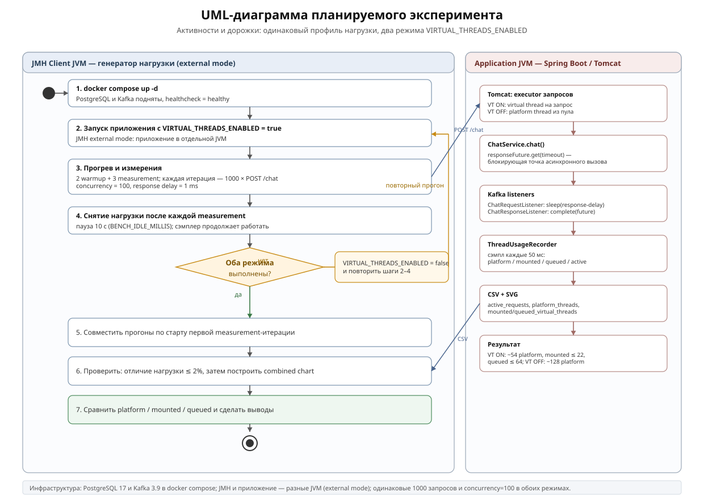
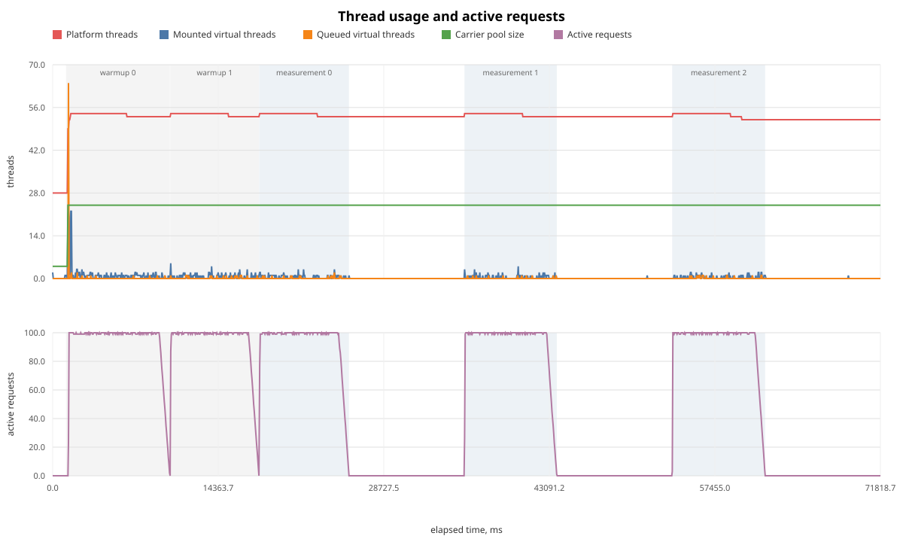
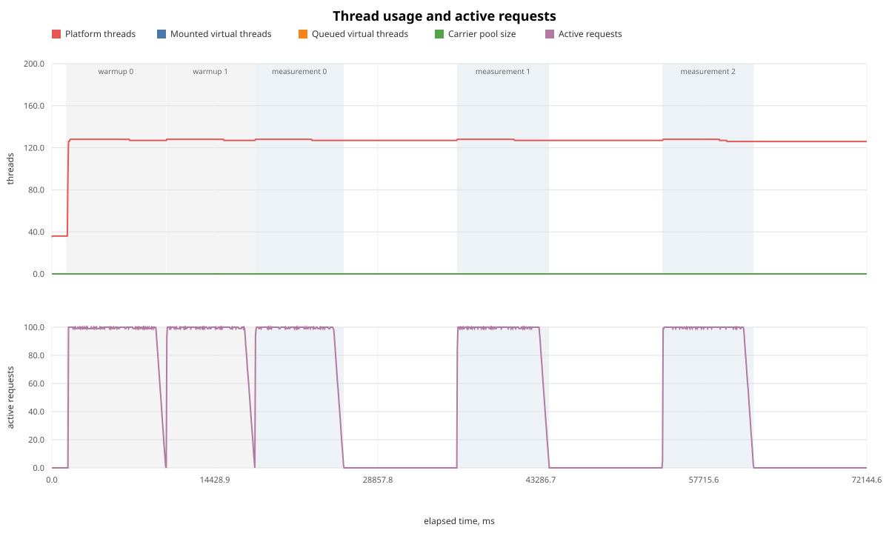
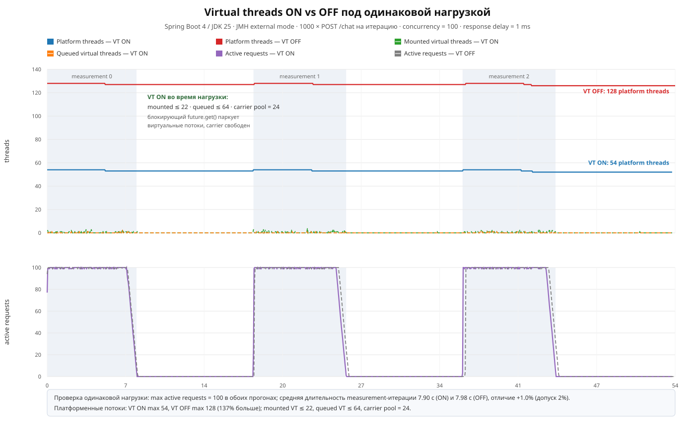

# Виртуальные потоки в Spring Boot Web на JDK 25: что даёт `spring.threads.virtual.enabled=true`

> Практическая статья на основе проекта `vthreads`: Spring Boot 4.1.2, JDK 25, PostgreSQL 17,
> Kafka 3.9. Один и тот же профиль нагрузки прогоняется дважды — с виртуальными потоками и без
> них — а затем профили потоков совмещаются на одном графике вместе с нагрузкой.

## Содержание

- [1. Проблема: thread-per-request и блокирующий I/O](#1-проблема-thread-per-request-и-блокирующий-io)
- [2. Как устроены виртуальные потоки](#2-как-устроены-виртуальные-потоки)
- [3. Виртуальные потоки в Spring Boot Web](#3-виртуальные-потоки-в-spring-boot-web)
- [4. Что именно блокируется в этом проекте](#4-что-именно-блокируется-в-этом-проекте)
- [5. UML-диаграмма планируемого эксперимента](#5-uml-диаграмма-планируемого-эксперимента)
- [6. Методика эксперимента](#6-методика-эксперимента)
- [7. Результаты](#7-результаты)
  - [7.1. График VT ON](#71-график-vt-on)
  - [7.2. График VT OFF](#72-график-vt-off)
  - [7.3. Совмещённый график](#73-совмещённый-график)
- [8. Объяснение результатов](#8-объяснение-результатов)
- [9. Выводы](#9-выводы)
- [10. Ограничения и на что обратить внимание](#10-ограничения-и-на-что-обратить-внимание)
- [11. Как воспроизвести](#11-как-воспроизвести)

## 1. Проблема: thread-per-request и блокирующий I/O

Классическая модель Spring MVC/Tomcat — один запрос на один платформенный (OS) поток.
Пока запрос ждёт ответа от базы, Kafka, HTTP-клиента или файловой системы, поток блокируется:
он остаётся занятым, но ничего не делает. Пул потоков Tomcat ограничен
(`server.tomcat.threads.max`, по умолчанию 200), поэтому при большом числе одновременных
«медленных» запросов:

- новые соединения ждут в очереди accept;
- растёт latency;
- каждый поток занимает память под стек и требует переключения контекста на уровне ОС;
- увеличивать пул до тысяч потоков экономически невыгодно.

Именно поэтому долгое время для I/O-нагрузок предлагали reactive-стек (WebFlux) или
асинхронные API. Виртуальные потоки (JDK 21+, в JDK 25 — стабильная и доработанная
технология) позволяют сохранить привычный императивный код и при этом не держать
платформенный поток на каждое ожидание.

## 2. Как устроены виртуальные потоки

Виртуальный поток (VT) — это поток, планируемый JVM, а не ОС. Он выполняется на небольшом
пуле **carrier-потоков** (по умолчанию `ForkJoinPool`, parallelism = числу доступных
процессоров). Когда виртуальный поток упирается в блокирующую операцию, поддерживаемую JDK
(`LockSupport.park`, `CompletableFuture.get`, `Socket` I/O, `Thread.sleep` и т.п.), JVM
**размонтирует** его: carrier освобождается и выполняет другие виртуальные потоки. Когда
ожидание завершается, VT ставится в очередь планировщика и снова монтируется на свободный
carrier.

Ключевые наблюдаемые величины:

| Метрика | Что означает |
| --- | --- |
| `platform_threads` | Потоки ОС в JVM (Tomcat, Kafka, HikariCP, JVM, carrier-потоки). |
| `mounted_virtual_threads` | Сколько VT прямо сейчас выполняется на carrier-потоках. |
| `queued_virtual_threads` | Сколько VT ждёт carrier в очереди планировщика. |
| `carrier_pool_size` / `parallelism` | Размер пула carrier-потоков и целевой parallelism. |
| `active_requests` | Сколько chat-запросов сейчас в обработке (наша нагрузка). |

Важно: у виртуального потока нет собственного потока ОС. Поэтому «много виртуальных потоков»
не означает «много потоков ОС».

## 3. Виртуальные потоки в Spring Boot Web

В Spring Boot достаточно одного свойства:

```yaml
spring:
  threads:
    virtual:
      enabled: ${VIRTUAL_THREADS_ENABLED:false}
```

При `true` Spring Boot настраивает Tomcat на использование виртуального потока на каждый
HTTP-запрос. Код контроллера и сервиса менять не нужно: `@RestController`, JDBC, Kafka,
`RestClient` остаются блокирующими. При `false` возвращается классический пул платформенных
потоков Tomcat.

В этом проекте флаг вынесен в переменную окружения `VIRTUAL_THREADS_ENABLED`, поэтому один и
тот же код запускается в двух режимах без пересборки.

## 4. Что именно блокируется в этом проекте

Сценарий `POST /chat`:

1. `ChatService` вставляет запись в PostgreSQL;
2. отправляет сообщение в Kafka-топик `chat-request`;
3. ждёт ответа из `chat-response` через `CompletableFuture`;
4. возвращает ответ клиенту.

Фрагмент `ChatService.chat()`:

```java
CompletableFuture<String> responseFuture = this.responseRegistry.register(id);
try {
    ChatRequestMessage message = new ChatRequestMessage(id, request, requestTime);
    this.kafkaTemplate.send(this.chatRequestTopic, id.toString(), message)
        .get(this.responseTimeout.toMillis(), TimeUnit.MILLISECONDS);
    return responseFuture.get(this.responseTimeout.toMillis(), TimeUnit.MILLISECONDS);
}
finally {
    this.responseRegistry.remove(id);
    ActiveRequests.decrement();
}
```

`responseFuture.get(...)` — это и есть точка блокировки асинхронного вызова. Веб-поток
проводит здесь почти всё время запроса, пока `ChatResponseListener` не completed future.

- **VT ON:** `future.get()` паркует виртуальный поток, тот размонтируется с carrier, и carrier
  обслуживает другие запросы. В очереди планировщика при этом видны `queued` VT.
- **VT OFF:** платформенный поток блокируется в ОС и не может обслуживать другие запросы,
  пока не придёт ответ.

Kafka-listener в проекте один (`spring.kafka.listener.concurrency=1` по умолчанию) и
имитирует обработку через `Thread.sleep(responseDelay)`. Поэтому в эксперименте именно
listener, а не веб-слой, ограничивает суммарную пропускную способность.

## 5. UML-диаграмма планируемого эксперимента



Диаграмма показывает две дорожки активности:

- **JMH Client JVM** — генератор нагрузки в отдельной JVM (external mode): 2 warmup- и
  3 measurement-итерации, по 1000 запросов `POST /chat`, `concurrency=100`; после каждой
  measurement-итерации нагрузка снимается на 10 секунд.
- **Application JVM** — Spring Boot/Tomcat, `ChatService` с блокирующим `future.get()`,
  Kafka-listeners, сэмплер `ThreadUsageRecorder` (каждые 50 мс) и запись CSV/SVG.

Эксперимент выполняется дважды с одинаковой нагрузкой: сначала `VIRTUAL_THREADS_ENABLED=true`,
затем `false`. Затем оба прогона совмещаются по старту первой measurement-итерации, проверяется
отличие нагрузки (допуск 2%) и строятся графики.

## 6. Методика эксперимента

| Параметр | Значение |
| --- | --- |
| JDK | 25 (Zulu 25.0.5) |
| Spring Boot | 4.1.2 |
| Инфраструктура | PostgreSQL 17, Kafka 3.9 (docker compose) |
| Режим JMH | `SingleShotTime`, external mode (приложение в отдельной JVM) |
| Запросов на итерацию | 1000 × `POST /chat` |
| `concurrency` | 100 |
| Задержка ответа listener-а | 1 мс (`BENCH_RESPONSE_DELAY=1ms`) |
| Warmup / measurement | 2 / 3 итерации |
| Пауза после measurement | 10 с (`BENCH_IDLE_MILLIS=10000`) |
| Сэмплирование потоков | каждые 50 мс |

Нагрузка в обоих прогонах задаётся одинаково: одно и то же число запросов, одинаковая
`concurrency` и одинаковая задержка. Это позволяет сравнивать не «разные нагрузки», а два
режима исполнения одного и того же сценария.

## 7. Результаты

### Сводная таблица

| Метрика | VT ON | VT OFF | Разница |
| --- | ---: | ---: | ---: |
| JMH Score | 7.951 ± 2.641 ms/op | 8.031 ± 3.070 ms/op | +1.0% |
| Время всего прогона | 71.82 с | 72.14 с | +0.45% |
| Средняя длительность measurement-итерации | 7.90 с | 7.98 с | +1.0% |
| Максимум активных запросов | 100 | 100 | 0% |
| Максимум платформенных потоков | **54** | **128** | **+137% (в 2.37 раза)** |
| Среднее платформенных потоков под нагрузкой | 53.6 | 127.6 | +138% |
| Максимум mounted VT | 22 | 0 | — |
| Максимум queued VT | 64 | 0 | — |
| Максимум carrier pool | 24 | 0 | — |
| Parallelism планировщика | 24 | — | — |

Нагрузка отличается меньше чем на 2%: 100 активных запросов в обоих прогонах, средняя
длительность measurement-итерации 7.90 с против 7.98 с (+1.0%). JMH Score также отличается
на 1.0%, что находится в пределах заявленного допуска.

### 7.1. График VT ON



Что видно:

- **Platform threads ~54** на всём прогоне. Это фон приложения (Tomcat, Kafka, HikariCP, JVM)
  плюс 24 carrier-потока. Число платформенных потоков **не растёт** вместе с `concurrency=100`.
- **Mounted virtual threads до 22** — столько VT одновременно выполняется на carrier-потоках
  (parallelism = 24).
- **Queued virtual threads до 64** — виртуальные потоки, готовые к выполнению и ожидающие
  свободный carrier.
- **Active requests до 100** — все 100 запросов находятся в обработке.
- В 10-секундных паузах после measurement-итераций `active_requests` падает до нуля,
  `mounted`/`queued` также падают до нуля, а платформенные потоки остаются на уровне ~53:
  пул приложения никуда не исчезает, но он и не разрастается под нагрузку.

Итого: 100 одновременно «висящих» на `future.get()` запросов обслуживаются небольшим
фиксированным набором carrier-потоков.

### 7.2. График VT OFF



Что видно:

- **Platform threads ~128** под нагрузкой. Это ~100 потоков Tomcat, занятых ожиданием ответа,
  плюс фоновые потоки приложения и JVM.
- **Mounted / queued VT = 0** — виртуальные потоки не используются.
- **Active requests до 100** — нагрузка та же, что и в VT ON.
- В паузах платформенные потоки остаются на уровне ~127: Tomcat держит пул, потоки не
  возвращаются в ОС, хотя запросов нет.

Итого: число платформенных потоков фактически следует за числом одновременных запросов.
При `concurrency`, превышающей `server.tomcat.threads.max`, запросы начнут ждать в очереди.

### 7.3. Совмещённый график



На одном графике совмещены оба прогона и нагрузка:

- верхняя панель — `platform_threads` для VT ON (синяя) и VT OFF (красная), а также
  `mounted`/`queued` для VT ON (зелёная и оранжевая пунктирные линии);
- нижняя панель — `active_requests` для обоих прогонов (фиолетовая и серая пунктирная);
- светло-синие полосы — measurement-итерации; между ними видны 10-секундные паузы без
  нагрузки.

Ключевое наблюдение: **линии нагрузки практически совпадают** (обе доходят до 100, длительности
отличаются на 1.0%), а платформенные потоки различаются более чем вдвое — 54 против 128.
Это изолирует эффект именно модели потоков: одинаковая работа выполняется с разным числом
потоков ОС.

## 8. Объяснение результатов

### Почему Score и throughput почти не изменились

В этом сценарии узкое место — **один Kafka-listener**: он обрабатывает сообщения
последовательно и задаёт общую пропускную способность ~125 запросов/с. Веб-слой при
`concurrency=100` не является ограничителем: и VT ON, и VT OFF успевают принять 100 запросов
и ждать ответа. Поэтому виртуальные потоки не могут «ускорить» listener и не меняют Score —
они меняют **стоимость ожидания** для веб-слоя.

Это важный и честный вывод: виртуальные потоки — не ускоритель сами по себе. Они убирают
ограничение «один занятый поток ОС на одно ожидание». Если downstream (Kafka consumer, БД,
внешний API) не масштабируется, VT не увеличат его пропускную способность.

### Почему платформенных потоков стало в 2.37 раза меньше

При `concurrency=100` VT OFF держит ~100 потоков Tomcat, каждый из которых заблокирован в
`future.get()`. VT ON держит 24 carrier-потока: 100 виртуальных потоков паркуются, а carrier
переиспользуются. Отсюда 54 платформенных потока (24 carrier + фон) вместо 128.

Если экстраполировать: 10 000 одновременных запросов в VT OFF потребовали бы порядка 10 000
потоков ОС (память под стеки, переключения контекста, давление на планировщик ОС), а в VT ON
число carrier-потоков осталось бы порядка числа ядер. Именно в этом и состоит преимущество
виртуальных потоков для I/O-bound нагрузки.

### Почему в паузах потоки не исчезают

Tomcat не уничтожает рабочие потоки сразу после нагрузки: пул остаётся «тёплым» (в VT OFF —
~127 потоков, в VT ON — ~53 фоновых/carrier). Это нормальное поведение пула. Разница в том,
что в VT OFF пул пропорционален пиковой конкурентности запросов, а в VT ON — числу ядер и
фоновым задачам.

### А если бы конкурентность была выше 200

`server.tomcat.threads.max` по умолчанию равен 200. При `concurrency > 200` в VT OFF часть
соединений ждала бы в очереди accept, а latency росла бы даже при свободном downstream.
В VT ON ограничение по числу одновременных запросов сдвигается к памяти и к downstream-пулам
(соединения БД, конкурентность Kafka-listener-а), а не к пулу потоков Tomcat. Наш эксперимент
специально проведён при `concurrency=100`, чтобы нагрузка была одинаковой и не упиралась в
лимит пула; эффект модели потоков при этом уже хорошо виден.

## 9. Выводы

1. **Виртуальные потоки в Spring Boot Web включаются одним свойством** и не требуют
   переписывания блокирующего кода на reactive. В эксперименте на JDK 25 при
   `concurrency=100` это дало **54 платформенных потока вместо 128** при той же нагрузке.
2. **Основной выигрыш — экономия потоков ОС и масштабируемость по конкурентности**, а не
   магическое ускорение latency. При одинаковой нагрузке Score изменился на 1.0% — в пределах
   шума, потому что ограничителем был Kafka-listener.
3. **VT особенно полезны там, где запрос долго ждёт I/O**: `CompletableFuture.get()`,
   JDBC, HTTP-клиенты, Kafka. В этом проекте 100 запросов «висели» на `future.get()`;
   виртуальные потоки парковались, а carrier-потоки продолжали работать.
4. **VT не заменяют тюнинг downstream.** Пропускная способность Kafka-listener-а, размер
   пула соединений БД и внешние API остаются ограничителями. Виртуальные потоки снимают
   ограничение веб-слоя, но не ускоряют БД и брокер.
5. **Для CPU-bound нагрузки выигрыша не будет**: там по-прежнему нужно число потоков порядка
   числа ядер, и VT не дают преимущества.
6. **На JDK 25 риск pinning существенно ниже**: начиная с JDK 24 `synchronized` больше не
   приводит к pinning-у виртуального потока (JEP 491), а в JDK 25 финализирован API
   `ScopedValue` (JEP 506). Остаточный pinning возможен в native-вызовах и некоторых
   сторонних библиотеках — это стоит проверять профилировщиком/JFR.
7. **Практическая рекомендация:** для типового Spring Boot Web-приложения с блокирующими
   I/O-вызовами включайте `spring.threads.virtual.enabled=true`, измеряйте
   `platform/mounted/queued` и `active_requests`, а масштабирование downstream (Kafka
   listener concurrency, пул БД) настраивайте отдельно.

## 10. Ограничения и на что обратить внимание

- **Один Kafka-listener** в демо-приложении — искусственное узкое место. Для более высокого
  throughput нужно увеличивать `spring.kafka.listener.concurrency` или менять дизайн
  обработки; тогда VT ON покажет преимущество и по пропускной способности.
- **`ThreadLocal`** на виртуальных потоках может размножаться по числу VT. Проверяйте
  библиотеки и по возможности используйте `ScopedValue`/явную передачу контекста.
- **Пул соединений БД** (HikariCP) остаётся ограниченным. 10 000 VT не сделают 10 000
  одновременных соединений к PostgreSQL полезными — им нужен пул и backpressure.
- **Pinning**: ищите события `jdk.VirtualThreadPinned` в JFR; блокировки в native-коде и
  некоторые библиотеки могут удерживать carrier.
- **Наблюдаемость**: thread dump с тысячами VT выглядит непривычно; используйте JFR,
  `VirtualThreadSchedulerMXBean` и сэмплер из этого проекта.

## 11. Как воспроизвести

```powershell
# 1. Инфраструктура
docker compose up -d

# 2. Прогон с виртуальными потоками
$env:VIRTUAL_THREADS_ENABLED="true"
$env:BENCH_RESPONSE_DELAY="1ms"
mvn -o test-compile exec:exec "-Djmh.concurrency=100"

# 3. Тот же прогон без виртуальных потоков
$env:VIRTUAL_THREADS_ENABLED="false"
mvn -o test-compile exec:exec "-Djmh.concurrency=100"

# 4. Совмещённый график и UML-диаграмма
python docs/article/build_report.py
```

Скрипт `build_report.py` читает `docs/article/vt-on.csv` и `docs/article/vt-off.csv`
(сырые сэмплы `ThreadUsageRecorder`), проверяет одинаковость нагрузки и строит
`vt-combined.svg` и `experiment-plan-uml.svg`. Отдельные графики прогонов —
`vt-on.svg` и `vt-off.svg`.

Файлы статьи:

| Файл | Назначение |
| --- | --- |
| `virtual-threads-spring-boot-jdk25.md` | Эта статья |
| `experiment-plan-uml.svg` | UML-диаграмма планируемого эксперимента |
| `vt-on.svg`, `vt-off.svg` | Графики отдельных прогонов |
| `vt-combined.svg` | Совмещённый график ON/OFF + нагрузка |
| `vt-on.csv`, `vt-off.csv` | Сырые сэмплы экспериментов |
| `build_report.py` | Генератор combined-графика и UML-диаграммы |
